# La Cajita

**Dinero de todos y para todos.** Pagos con QR y remesas para personas **con o sin cuenta de banco**, construidos sobre
[Open Payments](https://openpayments.dev) (Interledger).
Open Payments Hackathon · Medellín · 16–17 de octubre de 2026.

- **Con cuenta** (wallet o banco): el dinero llega directo a su wallet.
- **Sin cuenta**: el dinero queda en la **Custodia** a nombre de su cédula → le llega un **SMS** → responde **RETIRAR** →
  recibe un **PIN** → con **PIN + cédula** retira **todo su saldo** en efectivo en cualquier **corresponsal**.
  El retiro es un pago real de Open Payments: la Custodia le paga al Corresponsal, que entrega los billetes.

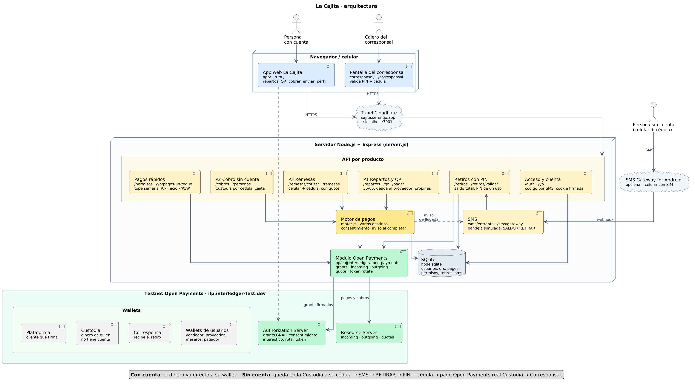

## Los tres productos

| # | Producto | Para quién | Qué hace |
|---|---|---|---|
| **P1** | **Pagos con reparto por porcentaje** | Vendedora que le debe a su proveedor; negocio que reparte propinas | Cada venta pagada con QR se divide sola: un porcentaje (p. ej. 35/65) va al proveedor **solo hasta saldar la deuda** y el resto a la vendedora. Con un **QR personalizado** (monto, vigencia, un solo uso) el extra se reparte entre los meseros. Incluye **pagos con un toque**: el cliente autoriza una vez un tope semanal y después paga sin volver a aprobar. |
| **P2** | **Cobro con QR + SMS** | Vendedor que solo quiere cobrar, sin app | El cliente paga el QR; si el vendedor no tiene cuenta, el dinero queda en la Custodia a su cédula y todo le llega por SMS. |
| **P3** | **Remesas** | Familia que recibe dinero (incluso desde el exterior) | Quien envía solo necesita el **celular y la cédula** de quien recibe. Se cotiza con un *quote* de Open Payments (cambio de moneda) y se muestra cuánto cuesta y cuánto llega. |

En P1, la persona **sin cuenta** acumula su parte en su **cajita** (un pago entrante sin monto en la Custodia). El
sistema la crea y la renueva solo: el usuario nunca ve «abrir» ni «cerrar», solo su saldo y el botón **Retirar**.

### Menú por SMS (sin app)
`MENU` · `SALDO` (o `1`) · `RETIRAR` (o `2`) · `AYUDA` (o `3`). Cada SMS corresponde a una operación real de Open
Payments: aviso de llegada confirmado con `incomingPayment.get`, saldo con `incomingPayment.list` sobre la Custodia y
retiro con un pago Custodia → Corresponsal.

### Cómo usa Open Payments
| Flujo | Operaciones |
|---|---|
| Venta con reparto (P1) | grant interactivo de *outgoing* en la wallet del cliente (`limits.debitAmount`) → un `outgoingPayment.create` por destino (proveedor, vendedora o su cajita, meseros), sin quote |
| Pagos con un toque | el mismo grant con `limits.interval: R/<inicio ISO>/P1W`; el token se guarda y se rota (`token.rotate`) si un pago devuelve 401 |
| Cobro sin cuenta (P2) | pago entrante con `incomingAmount` en la Custodia, con la cédula en la metadata |
| Remesa (P3) | pago entrante en el destino → `quote.create` en la wallet de quien envía → `outgoingPayment.create` con `quoteId` |
| Retiro | pago entrante en el Corresponsal con `expiresAt` = +24 h → al validar PIN + cédula, `outgoingPayment.create` desde la Custodia con un permiso autorizado una sola vez |

Los montos usan siempre el `assetCode`/`assetScale` de cada wallet.

**Documentación técnica completa** (arquitectura, módulo de Open Payments, flujos con diagramas de secuencia, modelo de
datos, API y limitaciones): [docs/TECNICA.md](docs/TECNICA.md).

| Reparto (P1) | Sin cuenta: SMS → PIN → corresponsal |
|---|---|
| 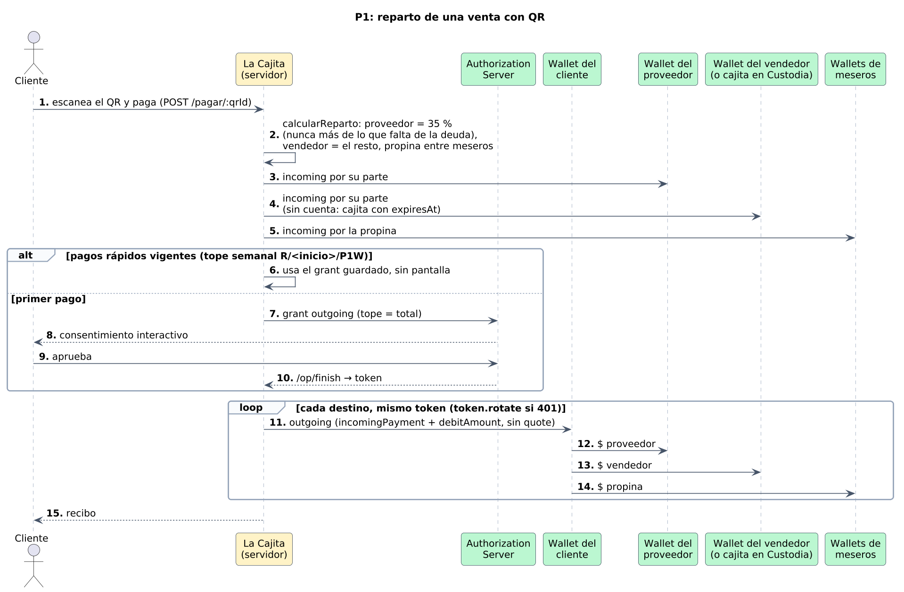 | 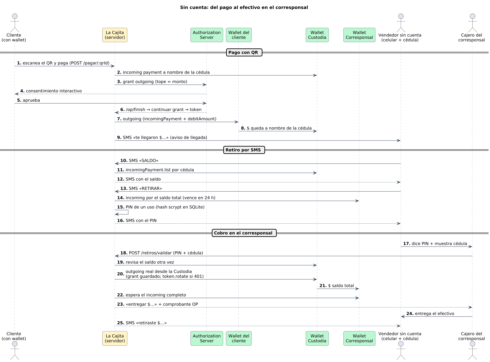 |

## Requisitos
- **Node.js ≥ 22.13** (usa `node:sqlite`, incluido en Node; no hay que instalar una base de datos).
- Una cuenta en la **Test Wallet** de Interledger: <https://wallet.interledger-test.dev>.
- Opcional: [`cloudflared`](https://developers.cloudflare.com/cloudflare-one/connections/connect-networks/downloads/)
  para abrir la app desde un celular, y la app [SMS Gateway for Android](https://docs.sms-gate.app) para enviar SMS reales.

## Wallets en la Test Wallet
Todas en el testnet (`https://ilp.interledger-test.dev/...`, nunca `$ilp…`). Los nombres son ejemplos:

| Wallet | Para qué | Variable del `.env` |
|---|---|---|
| **Plataforma** | Cliente de Open Payments que firma las solicitudes. En ella se genera la llave de desarrollador (*Developer Keys*): descarga `private.key` y copia el **Key ID** | `OP_CLIENT_WALLET_ADDRESS`, `OP_KEY_ID` |
| **Custodia** | Guarda el dinero de quien no tiene cuenta, a nombre de su cédula | `CUSTODIA_WALLET` |
| **Corresponsal** | Recibe el pago de cada retiro en efectivo | `CORRESPONSAL_WALLET` |
| **Vendedor** | Recibe las ventas del QR de ejemplo | `DEMO_VENDEDOR_WALLET` |
| **Proveedor**, **meseros** | Destinos del reparto (se escriben en la app al crear el reparto) | — |
| **Cliente** (con saldo) | Paga los QR; aprueba el consentimiento en la Test Wallet | — |
| **Remitente** en EUR o USD | Para probar la remesa con cambio de moneda | — |

Deposita saldo de prueba en las wallets que pagan (cliente, remitente). El permiso de retiros (paso 4 de abajo) lo
aprueba la cuenta de la Test Wallet dueña de la Custodia.

## Instalación y arranque
```bash
git clone https://github.com/ApollooProjects/OpenPaymentsHackathon2026Interledger-Apollo.git
cd OpenPaymentsHackathon2026Interledger-Apollo
cp .env.example .env
```

1. Completa el **`.env` en la raíz del repo** (no dentro de `backend/`).
2. Guarda la llave descargada como **`backend/private.key`**: debe coincidir con `OP_PRIVATE_KEY_PATH`, que es relativa a
   la raíz del repo. **Nunca se sube al repo** (`.gitignore` ya la bloquea).
3. Instala y arranca:
   ```bash
   cd backend && npm install && npm start
   ```
   El servidor escucha en el puerto de **`PORT`** (si falta, 3000) e imprime la URL al arrancar. La base de datos se
   crea sola en `data/cajita.sqlite`.
4. **Paso único: permiso de retiros de la Custodia.** Desde la raíz del repo:
   ```bash
   node scripts/permiso-custodia.js
   ```
   Imprime una URL: ábrela con la cuenta dueña de la Custodia y acepta. Al volver, el token queda guardado en SQLite y
   desde entonces cada retiro se paga sin aprobar de nuevo. Con `--probar` hace además un pago de prueba Custodia →
   Corresponsal; con un número (p. ej. `node scripts/permiso-custodia.js 500000`) pide el permiso con tope diario.

Pruebas unitarias (sin red, con `OP_MOCK=1`): `cd backend && npm test`.

### Variables del `.env`
| Variable | Para qué |
|---|---|
| `OP_CLIENT_WALLET_ADDRESS` | Wallet de la Plataforma (formato `https://`) |
| `OP_KEY_ID` | Key ID de la llave de desarrollador de esa wallet |
| `OP_PRIVATE_KEY_PATH` | Ruta a la llave, relativa a la raíz del repo: `./backend/private.key` |
| `OP_MOCK` | `0` = testnet real; `1` = sin red (solo para pruebas) |
| `PORT` | Puerto del servidor |
| `PUBLIC_URL` | URL pública del backend; la wallet redirige a `<PUBLIC_URL>/op/finish` tras el consentimiento y los QR apuntan aquí |
| `CUSTODIA_WALLET`, `CORRESPONSAL_WALLET` | Wallets del flujo sin cuenta |
| `DEMO_VENDEDOR_WALLET`, `DEMO_VENDEDOR_NOMBRE` | QR de ejemplo con cuenta (id `demo`) |
| `DEMO_SINCUENTA_NOMBRE`, `DEMO_SINCUENTA_CEDULA`, `DEMO_SINCUENTA_CELULAR` | QR de ejemplo sin cuenta (id `demo-sin-cuenta`), con datos inventados |
| `SMSGATE_USUARIO`, `SMSGATE_CLAVE`, `SMSGATE_FIRMA`, `SMSGATE_PERMITIDOS` | Opcional: SMS reales con SMS Gateway for Android, solo a los celulares permitidos |
| `SESION_SECRETO` | Firma la cookie de sesión; si falta, se genera uno al arrancar |

Sin SMS Gateway, los SMS (incluido el código para entrar) quedan en una **bandeja simulada**: `GET /sms/<celular>`, y se
responde con `POST /sms/entrante` (`{ "celular": "...", "texto": "RETIRAR" }`).

## Rutas principales
| Ruta | Qué es |
|---|---|
| `/` | App de La Cajita (mobile-first): entrar con celular, recibir con o sin cuenta, repartos, cobrar con QR, pagar, enviar remesas, retirar y perfil |
| `/corresponsal` | Pantalla del cajero del corresponsal: cédula + PIN → entrega el efectivo y dispara el pago Custodia → Corresponsal |
| `/#/pagar/<qrId>` | Página de pago a la que lleva cada QR |
| `/salud` | Comprobación del servidor |

API por producto: `/repartos`, `/qr`, `/qr/:qrId`, `/pagar/:qrId` (P1) · `/cobros`, `/personas` (P2) · `/remesas/cotizar`,
`/remesas` (P3) · `/retiros`, `/retiros/validar` (retiro) · `/permisos`, `/yo/pagos-un-toque` (pagos con un toque) ·
`/auth`, `/yo` (cuenta) · `/sms/entrante`, `/sms/gateway` (SMS).

## Abrir la app desde un celular
El QR se escanea con un celular y la wallet devuelve al usuario a nuestro backend después del consentimiento, así que el
backend necesita una URL pública con HTTPS. Con un túnel rápido de Cloudflare:

```bash
cloudflared tunnel --url http://localhost:<PORT>
```

`cloudflared` imprime una URL `https://<palabras>.trycloudflare.com`: ponla en `PUBLIC_URL`, reinicia el backend y ábrela
en el celular. Esa URL cambia cada vez que se reinicia el túnel (hay que actualizar `PUBLIC_URL` y volver a generar los QR);
con un túnel con nombre y dominio propio no cambia.

## Capturas
| | | |
|---|---|---|
| 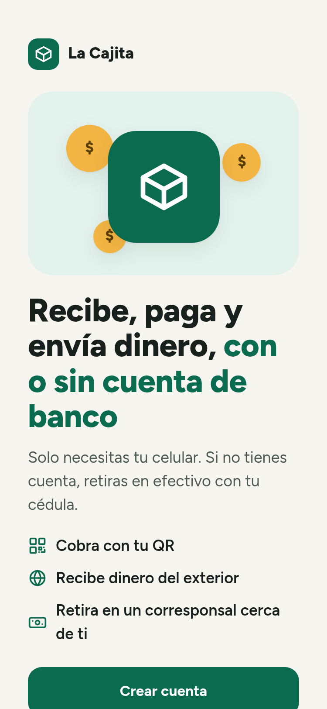 Portada | 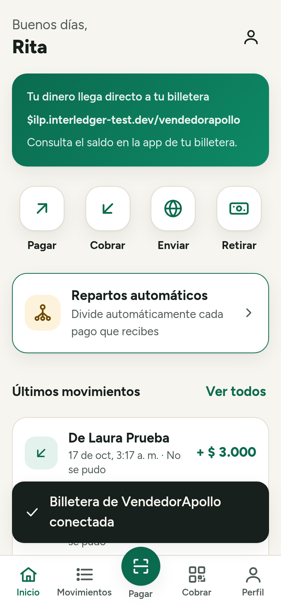 Inicio con cuenta | 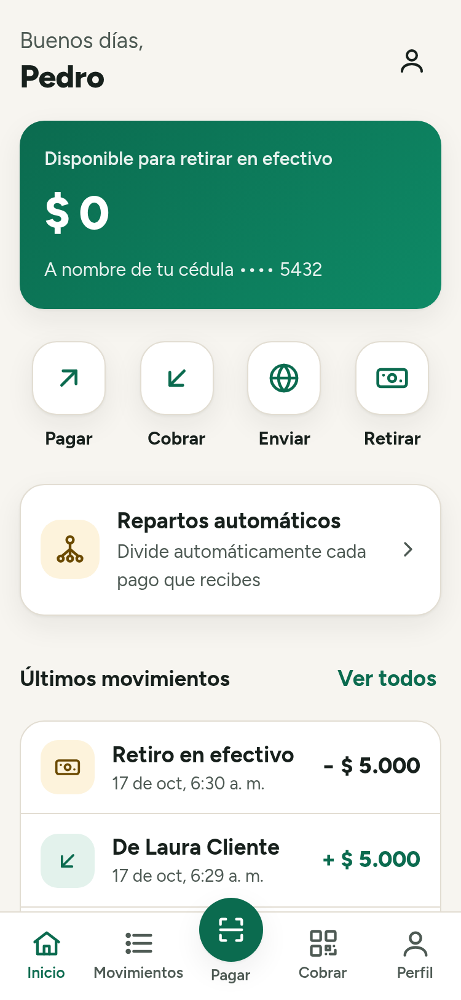 Inicio sin cuenta |
| 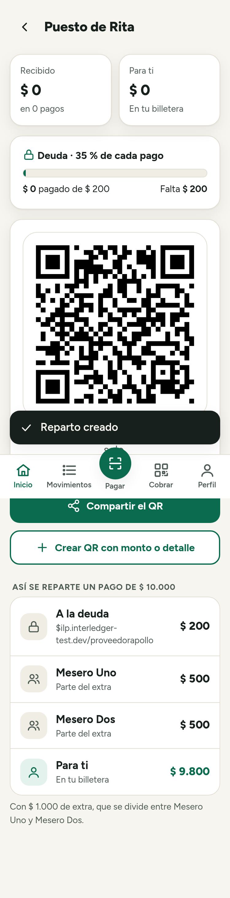 P1 · reparto y su QR | 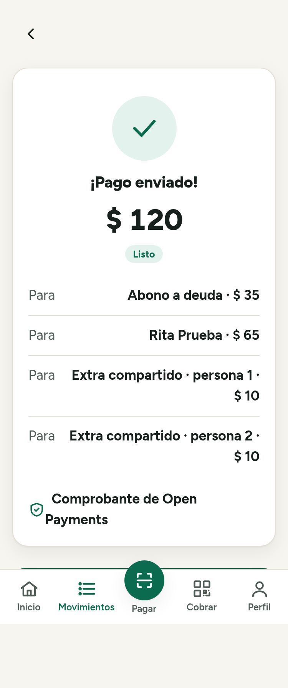 P1 · recibo: deuda, vendedora y meseros | 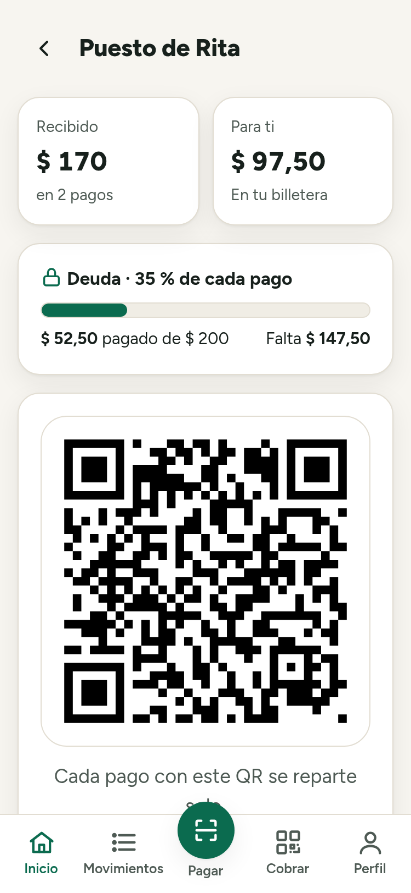 P1 · avance de la deuda |
| 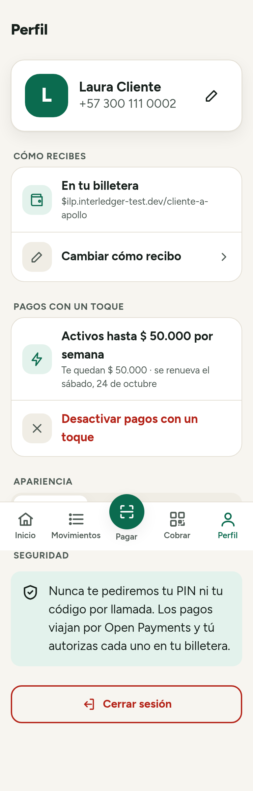 Pagos con un toque | 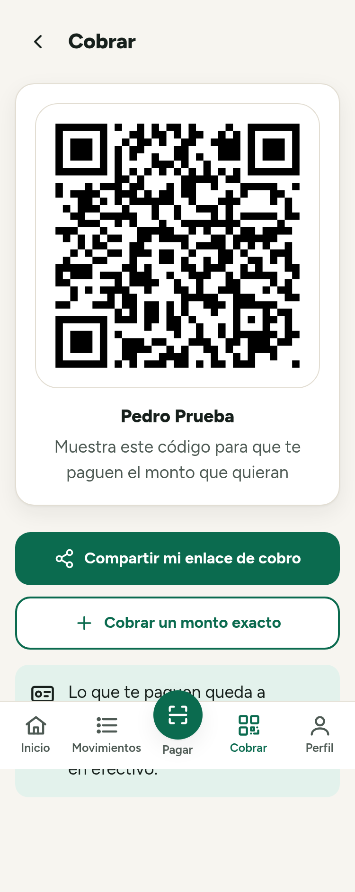 P2 · cobrar con QR sin cuenta | 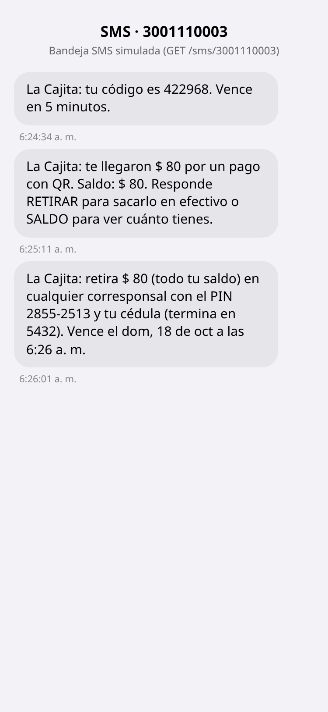 SMS: llegada y PIN |
| 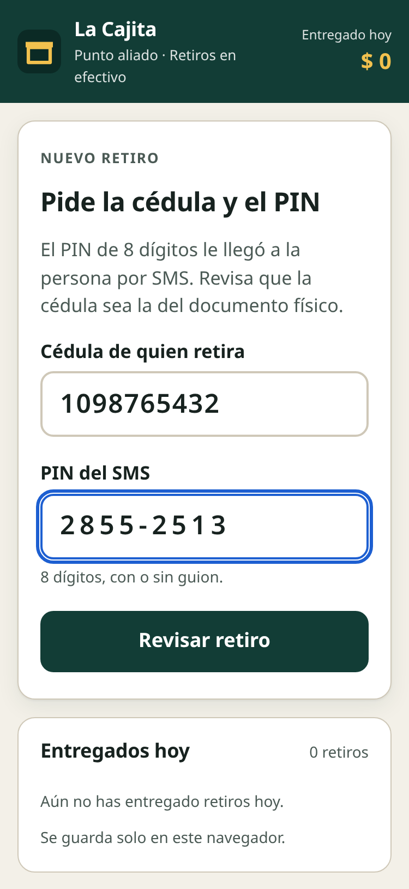 Corresponsal · cédula + PIN | 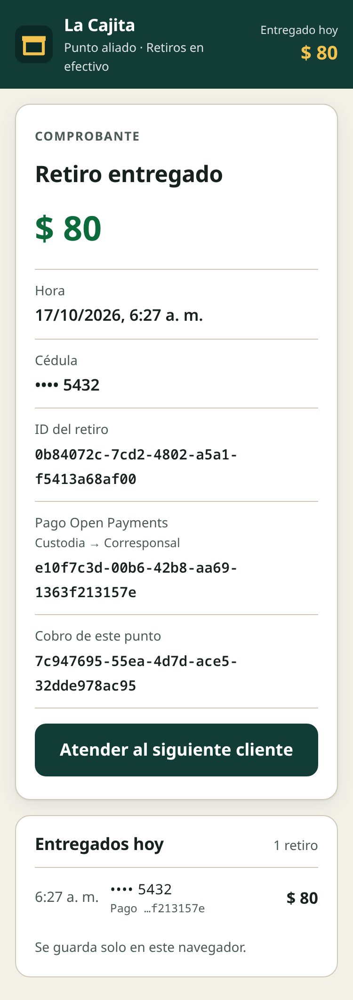 Corresponsal · entregado | 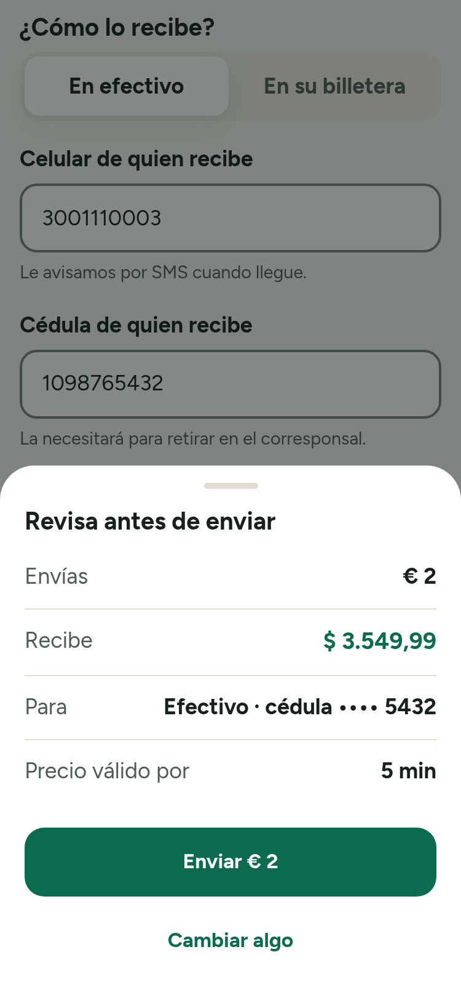 P3 · cotización (quote) |
| 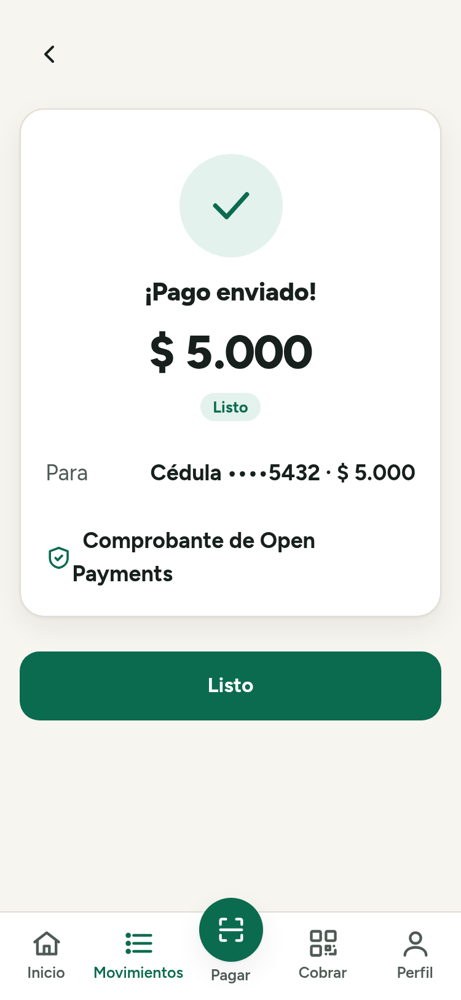 P3 · remesa enviada | | |

Todas las capturas usan datos de prueba inventados en el testnet de Open Payments.

## Estructura
```
backend/src/op/    módulo de Open Payments (grants, incoming, outgoing, quote, token)
backend/src/app/   servidor Express, motor de pagos, repartos, retiros, SMS, SQLite
app/               app web (HTML + JS sin build)
corresponsal/      pantalla del cajero
scripts/           permiso de la Custodia y pruebas contra el testnet
docs/              documentación técnica (TECNICA.md), diagramas y capturas
prompts/           prompts usados durante el desarrollo
```

## Uso de IA
Ver [AI_USAGE.md](AI_USAGE.md) y la carpeta [prompts/](prompts/).
