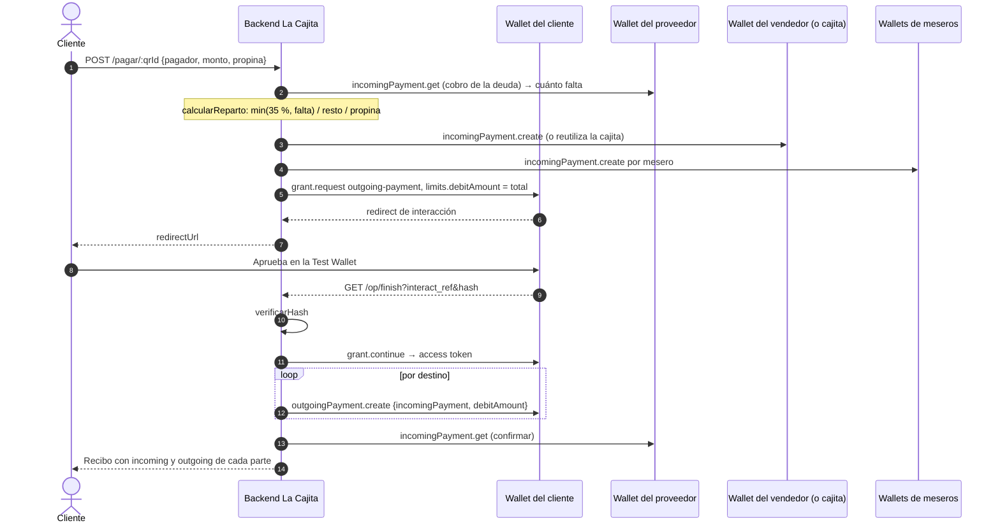
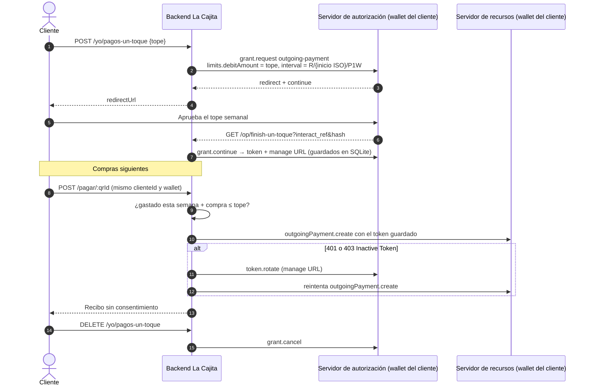
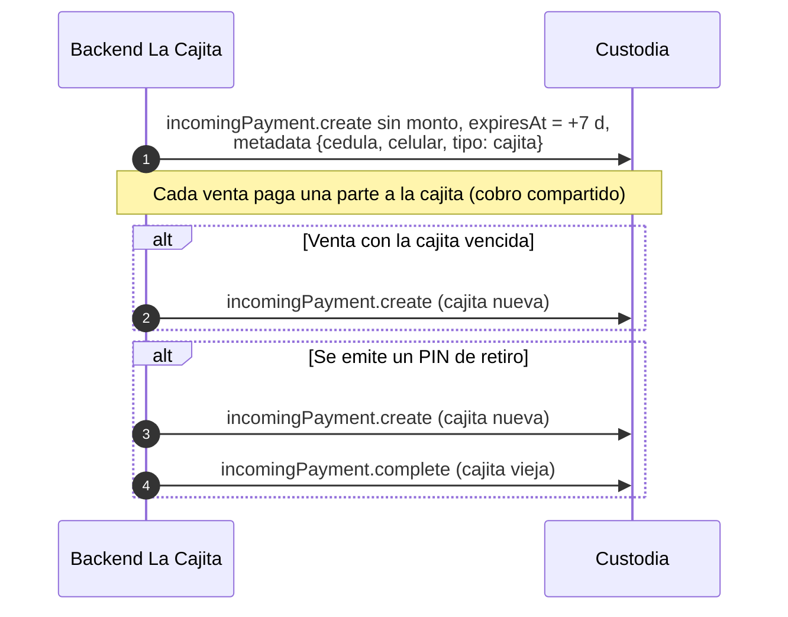
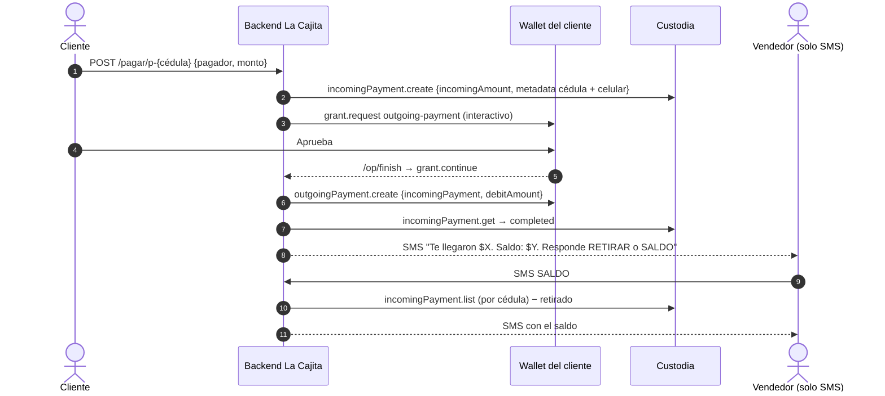
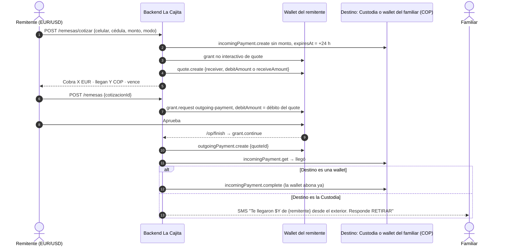
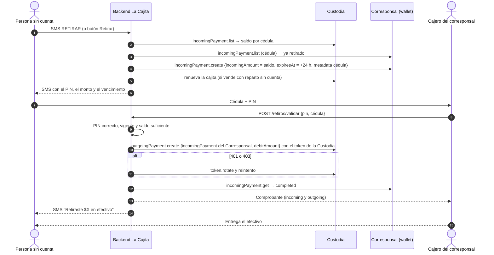

# La Cajita: documentación técnica

Cómo está construida La Cajita y cómo usa Open Payments. La instalación, las variables del `.env` y las wallets que hay
que crear están en el [README](../README.md); aquí se explica lo que pasa por dentro. Todo lo descrito corre contra el
testnet de Interledger (`https://ilp.interledger-test.dev/...`).

**Contenido**
1. [Arquitectura](#1-arquitectura)
2. [Módulo de Open Payments](#2-módulo-de-open-payments-backendsrcop)
3. [Motor de pagos](#3-motor-de-pagos)
4. [Flujos por producto](#4-flujos-por-producto)
   ([P1 reparto](#41-p1-venta-con-reparto-35--65-deuda-y-propinas) ·
   [pagos con un toque](#42-p1-pagos-con-un-toque) ·
   [cajita](#43-la-cajita-del-vendedor-sin-cuenta) ·
   [P2 cobro QR + SMS](#44-p2-cobro-con-qr--sms) ·
   [P3 remesas](#45-p3-remesas-con-quote) ·
   [retiro](#46-retiro-sms-retirar--pin--corresponsal))
5. [Modelo de datos](#5-modelo-de-datos-sqlite)
6. [API HTTP](#6-api-http)
7. [Decisiones y limitaciones conocidas](#7-decisiones-y-limitaciones-conocidas)
8. [Cómo correrlo y probarlo](#8-cómo-correrlo-y-probarlo)

---

## 1. Arquitectura

| Componente | Dónde | Qué hace |
|---|---|---|
| **Backend** | `backend/src/app/` | Node.js + Express. Sirve la API y los archivos estáticos de las dos pantallas. Contiene el motor de pagos, repartos, retiros, remesas, cuentas y SMS. |
| **Persistencia** | `backend/src/app/db.js` | SQLite con el módulo nativo `node:sqlite` (`DatabaseSync`, Node ≥ 22.13). Un archivo, `data/cajita.sqlite`; cada módulo crea sus tablas con `CREATE TABLE IF NOT EXISTS` al arrancar. `CAJITA_DB` permite otra base (p. ej. `:memory:` en las pruebas). |
| **Módulo de Open Payments** | `backend/src/op/` | Capa delgada sobre `@interledger/open-payments` (^7.4): grants, incoming payments, outgoing payments, quotes y rotación de tokens. Es lo único que habla con el testnet. Con `OP_MOCK=1` se cambia por `mock.js` (pruebas sin red). |
| **App del usuario** | `app/` | HTML + JS sin build, mobile-first, servida en `/`. Entrar con celular y código por SMS, elegir cómo recibir (billetera o efectivo), repartos, cobrar con QR, pagar, enviar remesas, retirar y perfil. |
| **Corresponsal** | `corresponsal/` | Pantalla del cajero, servida en `/corresponsal`: cédula + PIN → dispara el pago Custodia → Corresponsal y muestra el comprobante. |
| **SMS simulado** | `backend/src/app/sms.js` | Bandeja en SQLite por celular. Cada SMS saliente se guarda ahí; los entrantes llegan por `POST /sms/entrante`. Interpreta el menú `MENU` / `SALDO` (1) / `RETIRAR` (2) / `AYUDA` (3). |
| **SMS real** | `backend/src/app/smsReal.js` | Opcional, con SMS Gateway for Android. Los salientes se reenvían por su API (Basic auth); los entrantes llegan como webhook a `POST /sms/gateway`, firmado con HMAC-SHA256 (ventana de 5 min, comparación en tiempo constante, deduplicado por `messageId`). Solo actúa con los celulares de `SMSGATE_PERMITIDOS`. |
| **Túnel** | `cloudflared` | Da una URL pública con HTTPS (`PUBLIC_URL`): la wallet redirige ahí tras el consentimiento y los QR apuntan ahí. |

### Wallets del testnet

| Wallet | Papel |
|---|---|
| **Plataforma** (cliente de Open Payments) | Su wallet address y su llave (`OP_CLIENT_WALLET_ADDRESS`, `OP_KEY_ID`, `private.key`) firman todas las solicitudes HTTP (*HTTP Message Signatures*) con `createAuthenticatedClient`. No mueve dinero propio. |
| **Custodia** | Guarda el dinero de quien no tiene cuenta. Cada pago a una persona sin cuenta es un incoming payment en la Custodia con `metadata.cedula` y `metadata.celular`: **la persona existe solo como esa metadata**. |
| **Corresponsal** | Recibe un pago por cada retiro en efectivo (el corresponsal entrega los billetes y queda compensado en Open Payments). |
| **Wallets de usuarios** | Clientes que pagan, vendedores, proveedores, meseros, remitentes y destinatarios con cuenta. Pueden estar en distinta moneda (`assetCode`/`assetScale`). |

## 2. Módulo de Open Payments (`backend/src/op/`)

| Archivo | Funciones | Operaciones del SDK |
|---|---|---|
| `client.js` | `obtenerCliente`, `obtenerWallet`, `montoDeWallet` | `createAuthenticatedClient` (timeout de 20 s: listar los cobros de la Custodia tarda más que los 5 s por defecto), `walletAddress.get` |
| `grants.js` | `pedirPermiso`, `continuarPermiso`, `revocarPermiso`, `verificarHash` | `grant.request` (interactivo), `grant.continue`, `grant.cancel` |
| `incoming.js` | `crearCobro`, `consultarCobro`, `cerrarCobro`, `listarCobros` | `incomingPayment.create` / `getPublic` / `get` / `complete` / `list` (paginado de a 100) |
| `outgoing.js` | `pagar`, `consultarPago` | `outgoingPayment.create` con `incomingPayment` + `debitAmount` (sin quote), `outgoingPayment.get` |
| `quote.js` | `cotizar`, `pagarConCotizacion` | `quote.create` (`method: 'ilp'`, con `debitAmount` o `receiveAmount`), `outgoingPayment.create` con `quoteId` |
| `token.js` | `rotar` | `token.rotate` |
| `index.js` | fachada | Elige en cada llamada la implementación real o `mock.js` según `OP_MOCK`. |

### Grants GNAP

- **No interactivos** (`incoming-payment` y `quote`): la Plataforma los pide directamente al servidor de autorización de
  la wallet destino. Se guardan en memoria por `authServer` + acciones y se reutilizan hasta 30 s antes de su
  `expires_in` (600 s si no viene).
- **Interactivos** (`outgoing-payment`, acciones `create` y `read`): necesitan el consentimiento del dueño de la wallet que
  paga. `pedirPermiso` manda `interact.start: ['redirect']` y `interact.finish` con método `redirect`, la URI de vuelta
  (`<PUBLIC_URL>/op/finish…`) y un `nonce` aleatorio. El usuario aprueba en la Test Wallet; al volver, el backend
  **verifica el `hash`** (SHA-256 en base64 de `clientNonce \n interactNonce \n interact_ref \n authServer`) antes de
  llamar a `grant.continue` con el `interact_ref`. El access token resultante sirve para crear los outgoing payments y
  para leerlos después.
- **Límites**: `limits.debitAmount` = total de la compra (o el tope semanal) y, en los pagos con un toque,
  `limits.interval` = `R/{inicio ISO}/P1W` (el formato repetitivo ISO 8601; `P1W` solo falla). Sin tope el grant va sin
  `limits` (así se pide el de la Custodia).
- **Rotación**: si un pago devuelve **401**, o **403 "Inactive Token"** (como responde el testnet a un token vencido), se
  llama a `token.rotate` con la `manage` URL, se guarda el token nuevo y se reintenta ese pago una vez. Se usa con los
  tokens de larga vida: pagos con un toque y permiso de la Custodia.
- **Revocar**: cancelar los pagos con un toque hace `grant.cancel` (DELETE a la URI de continuación).

### Montos

Todos los montos son enteros en la unidad mínima (`value` como texto, cálculos con `BigInt`). `montoDeWallet` arma cada
monto con el `assetCode` y el `assetScale` **que publica la wallet** y falla si alguien intenta pagar en otra moneda o
escala; nunca se escriben a mano. El cambio de moneda solo ocurre en las remesas, vía quote.

## 3. Motor de pagos

`backend/src/app/motor.js` ejecuta un **plan de pago**: una wallet que paga y uno o varios destinos. Todos los productos
que cobran con QR o envían remesas pasan por él.

1. **`iniciarPago(plan)`**: por cada destino crea un incoming payment con `incomingAmount` (o reutiliza uno compartido:
   la cajita o el cobro de la deuda del proveedor). Suma el total en la moneda de quien paga.
2. Si el cliente tiene **pagos con un toque** vigentes con saldo semanal suficiente, paga ya con el token guardado.
   Si el token no sirve antes de mover dinero, lo marca vencido y cae al consentimiento normal.
3. Si no, pide **un solo grant interactivo** con `debitAmount` = total y devuelve la `redirectUrl` de la wallet.
4. **`terminarPago`** (en `/op/finish`): verifica el hash, continúa el grant y crea **un outgoing payment por destino**
   con el mismo token.
5. **`confirmar`**: los pagos se liquidan un instante después; lee cada incoming payment (`incomingPayment.get`) hasta 5
   veces. En un cobro propio basta `completed`; en uno compartido compara `receivedAmount` antes y después. Si no llega,
   consulta el outgoing payment: si la wallet lo marcó `failed` (p. ej. sin saldo), el pago queda `fallido`.
6. Al completarse corre los ganchos `onPagoCompletado`: SMS de llegada a quien no tiene cuenta y cierre del cobro de las
   remesas a wallet.

Estados: `esperando_consentimiento` → `procesando` → `enviado` → `completado` (o `rechazado` / `fallido`). El recibo
(`GET /pagos/:id`) muestra la prueba de Open Payments: wallet que pagó y, por destino, wallet, incoming payment,
outgoing payment y quote.

## 4. Flujos por producto

### 4.1 P1: venta con reparto (35 / 65, deuda y propinas)

- **Cálculo** (`reparto.js`, función pura con pruebas): proveedor = `venta × porcentaje / 100` (35 por defecto), pero
  **nunca más de lo que falta de la deuda**; vendedor = el resto. Opcionalmente un % de ahorro sale de la parte del
  vendedor hacia otra wallet. La **propina** se reparte entre los meseros en partes iguales o por porcentaje (deben sumar
  100); los centavos sobrantes van a los primeros para que la suma sea exacta. Sin meseros, la propina va al vendedor.
  Los destinos en 0 se omiten (Open Payments no acepta pagos de 0).
- **Deuda**: al crear el reparto se crea **un incoming payment en la wallet del proveedor con `incomingAmount` = deuda**.
  Cada venta le paga a ese mismo cobro; lo que falta se calcula como `deuda − receivedAmount`, leído del testnet.
  Saldada la deuda, la venta entera va al vendedor.
- **Un solo consentimiento** cubre todos los destinos: el grant pide `debitAmount` = total y luego salen N outgoing
  payments con `incomingPayment` + `debitAmount` (sin quote).
- **QR**: estático (el cliente escribe el monto) o personalizado con monto, meseros, vigencia (`410` si venció) y un
  solo uso (`409` si ya se pagó).

### 4.2 P1: pagos con un toque

El cliente autoriza **una vez** un tope semanal y después paga sin ver la pantalla de consentimiento
(`pagosRapidos.js`).

La semana se cuenta desde el inicio del `interval`, igual que la wallet. Si el permiso no alcanza o no sirve antes de
mover dinero, el pago cae al consentimiento normal.

### 4.3 La cajita del vendedor sin cuenta

La **cajita** existe solo en P1, para el vendedor sin cuenta. Es un **incoming payment en la Custodia sin
`incomingAmount`** (recibe cualquier cantidad de muchas ventas), con `expiresAt` explícito a **7 días** y metadata
`{cedula, celular, repartoId, tipo: 'cajita'}`. El sistema la crea y la renueva; el usuario nunca la abre ni la cierra.

- **Creación**: al crear un reparto sin cuenta.
- **Renovación al vender**: si la cajita venció, antes de armar la venta se crea otra.
- **Renovación al retirar**: cuando se emite un PIN (botón Retirar o SMS RETIRAR), por cada reparto sin cuenta de esa
  cédula se crea **primero la nueva** (para no perder ventas) y luego se completa la vieja con
  `incomingPayment.complete`. Lo que alcance a llegar a la vieja sigue a nombre de la cédula y entra en el siguiente
  retiro.

### 4.4 P2: cobro con QR + SMS

Para el vendedor que solo quiere cobrar. Se registra con nombre, cédula y celular (`POST /personas`, o desde la app con
"recibir en efectivo") y obtiene un QR estático `p-<cédula>` (o uno de un solo pago con monto y concepto). Cuando el
cliente paga, el destino es la **Custodia** con un incoming payment con `incomingAmount` y
`metadata {cedula, celular}`. Cuando el motor confirma el cobro (`incomingPayment.get`), sale un SMS con lo que llegó
(el `receivedAmount` real) y el saldo total; cada destino se avisa una sola vez (`avisos_llegada`).

### 4.5 P3: remesas con quote

Quien envía solo necesita el **celular y la cédula** de quien recibe (o su wallet, si tiene).

1. `POST /remesas/cotizar`: crea un incoming payment **sin monto** con `expiresAt` = +24 h en el destino (la Custodia con
   `{cedula, celular, tipo: 'remesa'}`, o la wallet del familiar) y pide un **quote** en la wallet de quien envía:
   modo `envio` (`debitAmount`: "envío X en mi moneda") o modo `recibe` (`receiveAmount`: "que lleguen exactamente Y").
   Devuelve cuánto se cobra, cuánto llega y cuándo vence la cotización.
2. `POST /remesas`: si la cotización no venció (si no, `410`), el motor pide el grant interactivo con `debitAmount` =
   débito del quote y paga con `outgoingPayment.create` + `quoteId`.
3. **Cierre del incoming al confirmarse**: un cobro sin monto nunca se completa solo, así que la wallet del familiar lo
   mostraba pendiente hasta que vencía. Al confirmarse la remesa, el backend lo cierra con `incomingPayment.complete`
   para que la wallet abone el dinero de inmediato. Los cobros de la Custodia no se cierran: el saldo por cédula se
   calcula sobre ellos.

### 4.6 Retiro: SMS RETIRAR → PIN → corresponsal

El retiro siempre es **del saldo total** y es un pago real de Open Payments **Custodia → Corresponsal**.

- **Saldo** (`retiros.js`): suma de `receivedAmount` de los incoming payments de la Custodia con esa cédula, menos lo
  ya retirado (los incoming del Corresponsal con esa cédula, más los retiros locales en curso). Como sale del testnet,
  es el mismo en cualquier máquina que corra el backend.
- **Por SMS** solo se conoce el celular: la cédula sale del vínculo celular → cédula (`vinculos_celular`), y el PIN va
  siempre al celular vinculado a la cédula.
- **PIN**: 8 dígitos (`1234-5678`), guardado con `scrypt` + sal y comparado en tiempo constante; vence a las 24 h. Un PIN
  nuevo anula el anterior; las solicitudes van en fila para que dos RETIRAR simultáneos no dejen dos PIN activos.
- **Permiso de la Custodia**: un grant interactivo de `outgoing-payment` que aprueba **una sola vez** la dueña de la
  Custodia con `scripts/permiso-custodia.js`; el token y la manage URL quedan en la tabla `permisos` y se rotan en
  401/403.

Si el pago sigue en curso, `/retiros/validar` responde `202` y el cajero vuelve a validar; si la wallet lo marca
`failed`, el retiro vuelve a `activo` para reintentar.

## 5. Modelo de datos (SQLite)

| Tabla | Módulo | Qué guarda |
|---|---|---|
| `qrs` | `store.js` | QR: vendedor, wallet destino, tipo (`estatico`, `transferencia`, `efectivo`), monto (un solo uso), meseros, vigencia, si pide propina, reparto y descripción. |
| `pagos` | `store.js` | Cada pago del motor: estado, wallet que paga, `plan` (JSON con destinos, incoming/outgoing de cada uno, tope, origen) y `permiso` (datos del grant y token). |
| `repartos` | `store.js` | Reparto P1: proveedor, porcentaje, deuda y su incoming (`deuda_cobro_id`), con o sin cuenta, wallet del vendedor o cédula/celular, cajita (`cajita_id`, `cajita_vence`), ahorro. |
| `pagos_rapidos` | `store.js` | Pagos con un toque por cliente: wallet, tope semanal, inicio del interval, estado y datos del grant (token, manage URL, continue). |
| `permisos` | `store.js` | Tokens de larga vida por clave (p. ej. `custodia`): token y manage URL. |
| `retiros` | `store.js` | Retiros: cédula, celular, monto, incoming del Corresponsal, hash y sal del PIN, vencimiento, estado (`activo`, `pagando`, `entregado`, `anulado`, `vencido`), outgoing payment. |
| `personas_sin_cuenta` | `sinCuenta.js` | QR de P2 → nombre, cédula y celular. |
| `avisos_llegada` | `sinCuenta.js` | Qué destinos de qué pago ya recibieron su SMS (evita repetirlo). |
| `vinculos_celular` | `vinculos.js` | Celular → cédula (un celular pertenece a una sola cédula). |
| `cotizaciones_remesa` | `remesas.js` | Cotizaciones de P3: remitente, destino con su incoming, quote y el pago que la usó (una cotización sirve una vez). |
| `usuarios` | `cuentas.js` | Usuarios de la app: celular, nombre, tipo (`billetera` o `efectivo`), wallet o cédula y su QR fijo. |
| `codigos_acceso` | `cuentas.js` | Código de entrada por SMS (hash, vence a los 5 min, intentos). |
| `sesiones` | `cuentas.js` | Sesiones: solo el hash del token (la cookie va firmada con HMAC y dura 30 días). |
| `repartos_usuario` | `cuentas.js` | Repartos creados desde la app y sus reglas. |
| `sms` | `sms.js` | Bandeja de SMS simulada (entrantes y salientes por celular). |
| `sms_gateway_vistos` | `smsReal.js` | `messageId` de los webhooks ya procesados. |

El dinero no vive en SQLite: saldos, deuda pagada y retiros se leen de los incoming payments del testnet. La base guarda
la configuración, el estado de los pagos y los tokens.

## 6. API HTTP

| Método y ruta | Para qué |
|---|---|
| `POST /auth/codigo` · `POST /auth/entrar` · `POST /auth/salir` | Entrar a la app con celular + código por SMS; sesión en cookie. |
| `GET` / `PATCH /yo` | Usuario de la sesión; cambiar nombre. |
| `POST /yo/billetera` · `POST /yo/efectivo` | Elegir cómo recibir: wallet (con cuenta) o cédula (sin cuenta, Custodia). |
| `GET /yo/resumen` | Saldo, PIN pendiente, movimientos y QR fijo del usuario. |
| `POST /yo/qr` | QR fijo o de un solo pago (monto, concepto). |
| `GET` / `POST /yo/repartos` · `POST /yo/repartos/:id/qr` · `GET /yo/recibido-por-repartos` | Repartos P1 del usuario, sus QR y lo recibido. |
| `GET` / `POST` / `DELETE /yo/pagos-un-toque` · `GET /op/finish-un-toque` | Pagos con un toque: estado, activar (consentimiento), revocar y vuelta del consentimiento. |
| `POST /repartos` · `GET /repartos/:id` · `POST /repartos/:id/retirar` | Crear un reparto, ver su resumen (saldo, deuda, ventas) y retirar (sin cuenta). |
| `POST /qr` · `POST /qr/transferencia` · `GET /qr/:qrId` · `GET /qr/:qrId/imagen` | Crear QR personalizado o de transferencia, datos públicos del QR y su imagen SVG. |
| `POST /pagar/:qrId` | Iniciar el pago de un QR: devuelve `redirectUrl` (consentimiento) o el estado (pago con un toque). |
| `GET /op/finish` | Vuelta del consentimiento: verifica hash, continúa el grant y paga. |
| `GET /pagos/:id` | Estado y recibo del pago (confirma contra el testnet si sigue `enviado`). |
| `POST /personas` | Registrar a alguien sin cuenta y darle su QR (P2). |
| `GET /cobros?wallet=` | Lo que le ha llegado a una wallet (meseros, proveedor) y la deuda pendiente. |
| `POST /remesas/cotizar` · `POST /remesas` | Cotizar (quote) y enviar una remesa (P3). |
| `POST /retiros` · `POST /retiros/validar` | Pedir el PIN por cédula o celular; validar PIN + cédula en el corresponsal. |
| `POST /permisos` · `GET` / `DELETE /permisos/:clienteId` | Pagos con un toque por `clienteId` (API sin sesión). |
| `GET /sms/:celular` · `POST /sms/entrante` · `POST /sms/gateway` | Bandeja simulada, SMS entrante simulado y webhook del gateway real. |
| `GET /salud` | Comprobación del servidor y de la base. |

Los errores salen como `{ error }` con un mensaje para el usuario (`errores.js`); `400` para datos inválidos, `404`
no encontrado, `409` QR o cotización ya usados, `410` QR o cotización vencidos.

## 7. Decisiones y limitaciones conocidas

**Decisiones**
- **Custodia sin tope diario.** El permiso de la Custodia se pide sin `limits` por defecto: como cada retiro es el
  saldo total, un tope diario dejaría sin poder retirar a quien tenga más que el tope. El script acepta un número para
  pedirlo con tope si se quiere.
- **Outgoing sin quote** cuando la moneda es la misma (`incomingPayment` + `debitAmount`); quote solo en remesas.
- **La persona sin cuenta no tiene cuenta en ningún lado**: su identidad es la metadata de los cobros en la Custodia y
  el saldo se calcula desde el testnet.
- **Un consentimiento por compra** aunque la venta se divida en varios destinos.
- Supuesto del pitch: todas las billeteras hablan Open Payments.

**Limitaciones**
- **La cotización vence en unos 5 minutos** (`expiresAt` del quote en el testnet). Si se envía después, la API
  responde `410` y hay que volver a cotizar.
- **Mesero sin cuenta no tiene cajita**: los meseros del reparto necesitan una wallet; la propina no puede ir a la
  Custodia a nombre de una cédula.
- **El QR del vendedor de P2 sin app**: hoy lo obtiene registrándose en la app ("recibir en efectivo") o con
  `POST /personas`; no hay un canal solo por SMS para pedir el QR.
- **`/yo/resumen` es lento** para quien recibe en efectivo: lista y pagina todos los incoming payments de la Custodia y
  del Corresponsal para calcular el saldo (por eso el timeout del cliente es de 20 s).
- **El testnet invalida antes de tiempo el token de lectura**: el token del grant de compra se usa también para leer
  el outgoing payment y saber si falló; a veces el testnet ya no lo acepta. Ese error se ignora y el pago se confirma
  leyendo el incoming payment.
- La URL de un túnel rápido cambia en cada reinicio (hay que actualizar `PUBLIC_URL` y regenerar los QR).
- El corresponsal y la entrega de efectivo están simulados; el pago Custodia → Corresponsal sí es real.

## 8. Cómo correrlo y probarlo

La instalación paso a paso está en el [README](../README.md#instalación-y-arranque). En resumen: `.env` en la raíz con
la wallet de la Plataforma, su Key ID y la llave en `backend/private.key`; `cd backend && npm install && npm start`; una
vez, `node scripts/permiso-custodia.js` para el permiso de retiros; y un túnel (`PUBLIC_URL`) para abrirla desde un
celular.

- **Pruebas unitarias** sin red (`OP_MOCK=1`): `cd backend && npm test` (reparto, cuentas, repartos del usuario).
- **Pruebas contra el testnet** en `scripts/`: `probar-grants.js`, `probar-cajita.js`, `probar-cotizacion.js` y
  `permiso-custodia.js --probar` (pago de prueba Custodia → Corresponsal).
- **Recorrido manual**: crear un reparto con deuda y pagar su QR desde la wallet del cliente; pagar un QR sin cuenta y
  leer el SMS en `GET /sms/<celular>`; responder `RETIRAR` con `POST /sms/entrante` y validar el PIN en
  `/corresponsal`; cotizar y enviar una remesa desde una wallet en otra moneda. Cada recibo muestra los incoming y
  outgoing payments, que se pueden comprobar en la Test Wallet.
